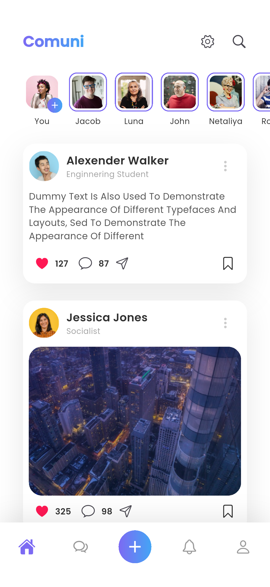
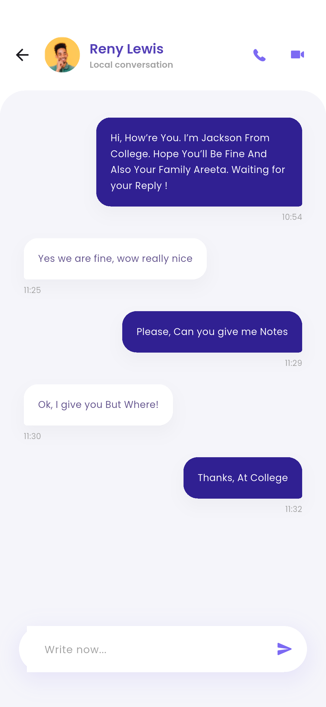
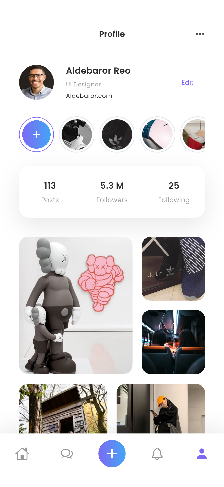
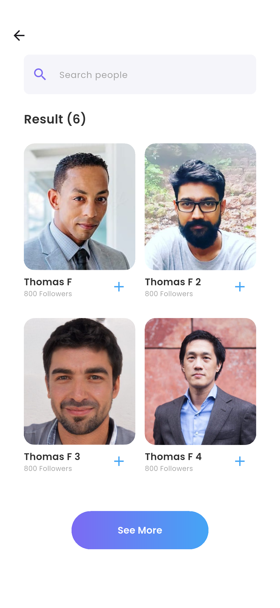
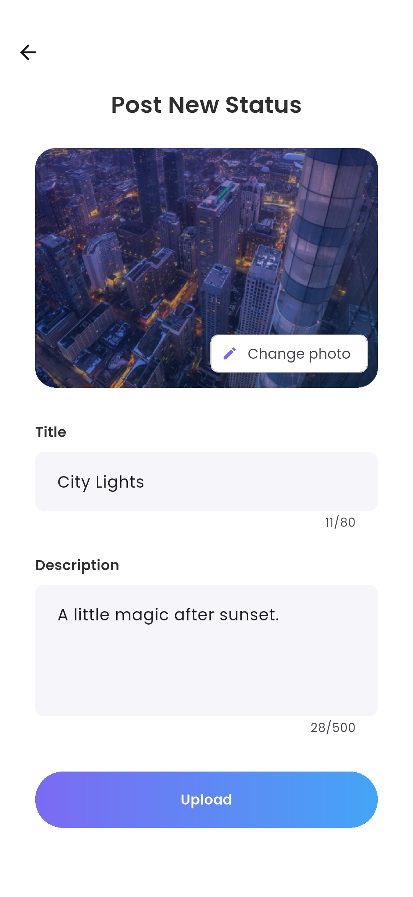
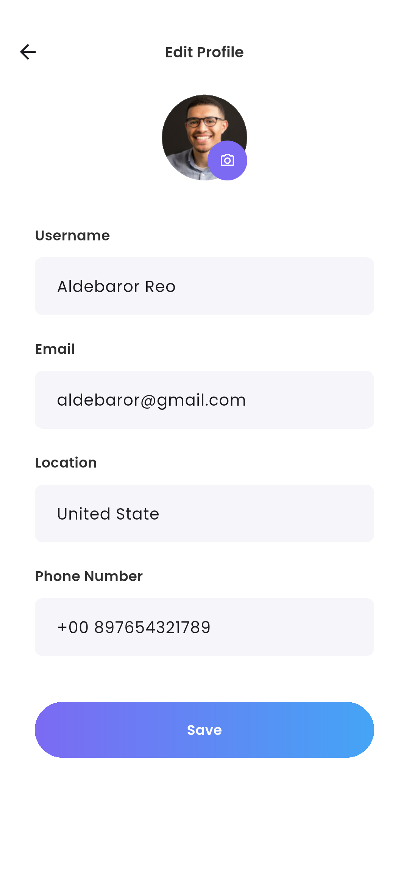

# Comuni · Flutter 社交应用

依据 Pixso 文件 **Comuni Social Media app → Comuni Social Media App** 开发的可运行 Flutter 应用。保留参考稿的英文界面、Poppins 字体、紫蓝渐变、白底卡片、故事栏和照片布局。设计基准为 414 × 896，并适配系统安全区域、窄屏、横屏和键盘。

这是一个**本地交互演示应用**：页面是 Flutter 原生组件，按钮与输入框可操作；资料、动态、收藏、好友和聊天记录保存在设备本地。未连接服务端，登录不验证真实账号，短信、Google/Facebook 登录、语音视频通话与直播不提供真实服务。

## 主要界面

以下图片来自 Android 模拟器运行截图，非 Pixso 静态设计导出。

| 首页动态 | 消息会话 | 个人主页 |
| --- | --- | --- |
|  |  |  |

| 搜索好友 | 发布动态 | 资料编辑 |
| --- | --- | --- |
|  |  |  |

完整页面与状态截图见 [界面截图索引](docs/界面截图索引.md)。原始 31 张设计参考见 [Pixso 设计映射](docs/Pixso设计映射.md)，导出文件保存在 `docs/design/`；实际应用截图保存在 `docs/screenshots/`。

## 运行与体验

开发环境：Flutter 3.47.7 / Dart 3.13.5。已生成 Android、iOS 和 Web 工程。

```sh
flutter pub get
flutter devices
flutter run -d emulator-5554
```

也可以运行 Web 版本：

```sh
flutter run -d chrome
```

iOS 需在 macOS 中配置 Xcode 后运行，当前 Windows 环境没有执行 iOS 编译验证。

- 首次启动：启动页 → 三页引导 → Welcome → 注册。
- 注册：填写姓名、有效邮箱或手机号、至少 6 位密码；两次密码一致；下一步输入手机号，使用演示验证码 **7835**。
- 登录：任何有效格式的邮箱或手机号 + 至少 6 位密码均可进入本地演示。密码不存储到本地，也不会发送到网络。
- 忘记密码：展示表单与请求结果说明，不发送短信或邮件。
- 发布：点击底部 `+`，填写标题，可选图片和描述。图片支持系统相册，也提供 `Use demo photo`，可不选图发布文字动态。
- 群组：消息页右上角创建，填写名称、选择模板、勾选至少一个好友后创建。
- 收藏：点击动态书签，再从设置的 Favorites 查看。
- 会话删除：消息列表向左滑动，在确认框选择 Delete。
- 再次启动：记住登录状态与本地内容；Logout 退出登录但保留本机演示内容。

Android 安装包位于 `dist/comuni-android-arm64.apk`（ARM64 真机，演示签名）和 `dist/comuni-emulator-x64.apk`（x86_64 模拟器）。安装包不属于正式商店发布版本。ARM64 约 24.3 MB，模拟器包约 25.7 MB；校验值见 `dist/SHA256SUMS.txt`。

## 已实现的页面与交互

| 模块 | 界面 | 行为 |
| --- | --- | --- |
| 启动与引导 | Splash、三页 Onboarding、Welcome | 自动启动跳转、滑动切换、Next、Skip、记住引导完成状态 |
| 账号入口 | Register、Phone、Verify、Log In、Forget Password | 输入校验、密码显隐、确认密码、演示验证码校验、重发倒计时、退出登录 |
| 动态 | Home、Post、Comments | 点赞、收藏、复制分享文案、查看照片详情、发送评论 |
| 发现 | Search、Notification、公开 Profile | 实时搜索、查看更多、添加／移除好友、关注状态切换、进入会话 |
| 消息 | Messages、Chat、Create Group、删除状态 | 会话筛选、未读清除、发送文字、更新摘要、模板选择、群组创建、滑动删除 |
| 个人资料 | Personal Profile、Edit Profile、Settings | 编辑姓名／邮箱／位置／电话、相册选择头像、保存资料、本地通知偏好 |
| 内容 | Post New Status、Story、Live Story、Albums、Favorites、Friends | 本地图文发布、演示照片、故事点赞与当前会话内评论、相册预览、收藏与好友空状态 |

系统图片选择已接入 `image_picker`，iOS 相册用途说明已配置。自动测试使用演示照片，未通过自动化调用系统相册或验证真实设备相册权限。

## 项目结构

```text
ComuniSocial/
├── lib/
│   ├── main.dart                     # 初始化 Flutter、系统栏、本地状态
│   ├── app.dart                      # MaterialApp、全局主题、宽屏内容约束
│   ├── data/
│   │   ├── models.dart               # Post / Conversation / ChatMessage
│   │   └── social_store.dart         # 演示数据、业务操作、JSON 持久化、StoreScope
│   ├── ui/
│   │   ├── theme.dart                # 颜色、渐变、字体、输入框样式
│   │   └── widgets.dart              # 头像、图片、按钮、卡片、搜索与输入栏
│   └── features/
│       ├── shell.dart                # 四个主 Tab 与中央发布入口
│       ├── auth/
│       │   ├── onboarding_screens.dart
│       │   ├── auth_screen.dart
│       │   ├── verification_screens.dart
│       │   └── auth_navigation.dart
│       ├── feed/
│       │   ├── feed_screen.dart
│       │   ├── post_widgets.dart
│       │   ├── post_screens.dart
│       │   ├── discovery_screens.dart
│       │   ├── compose_screen.dart
│       │   └── story_screen.dart
│       ├── messaging/
│       │   ├── messages_screen.dart
│       │   ├── chat_screen.dart
│       │   └── create_group_screen.dart
│       └── profile/
│           ├── profile_screen.dart
│           ├── edit_profile_screen.dart
│           ├── settings_screen.dart
│           └── collection_screens.dart
├── assets/
│   ├── fonts/                        # Poppins 字体与 OFL 许可证
│   └── images/                       # 从 Pixso 导出的头像、照片、插画、Logo
├── android/ ios/ web/                # 平台工程
├── test/widget_test.dart             # 持久化、主要业务与响应式布局测试
├── integration_test/app_test.dart     # Android 真实页面流程与截图
├── scripts/capture_screenshots.py     # 执行集成测试并收集截图
├── docs/                             # 设计参考、应用截图、测试记录、映射文档
└── dist/                             # 可安装的演示 APK
```

每个功能目录的 `*_screens.dart` 是少量 `export` 声明，统一对外暴露页面；实际实现位于相应独立文件。页面按功能分组，避免一个文件容纳全部 UI。

## 架构与数据流

采用轻量的 **页面层 → 状态／操作层 → 本地存储层**：

1. 页面读取 `StoreScope.of(context)`，事件调用 `SocialStore` 的 `like`、`bookmark`、`comment`、`send`、`publish` 等方法。
2. `SocialStore` 继承 Flutter 原生 `ChangeNotifier`，更新模型并通知相关页面重建。
3. `StoreScope` 使用 `InheritedNotifier` 分发同一个状态实例。主导航用 `IndexedStack` 保留 Tab 状态；二级页面使用 `Navigator`。
4. 需要保存时生成完整 JSON 快照，用 `shared_preferences` 存入 `comuni.v1`。写入按顺序排队，避免连续操作造成旧值覆盖新值；`flush()` 可等待保存完成。
5. 启动时恢复状态；内容损坏时使用新演示数据，并显示可关闭提示。存储失败时提示用户，当前内存数据仍可继续使用。

这是便于演示和后续扩展的结构。照片缩放后以 Base64 放入本地快照，适合少量演示内容；若接入真实业务，应把照片迁移到文件／对象存储，把动态与聊天数据迁移到数据库／API，并在 repository 边界接入真实身份验证与授权。

### 本地保存范围

保存：引导完成、演示登录状态、个人资料与头像、动态及其点赞／收藏／评论、好友集合、关注状态、会话消息／未读数／群组、本地通知偏好。

不保存：注册／登录密码、验证码输入框、搜索关键词、未提交的编辑内容、单次故事页的点赞与评论、评论行的临时点赞。通知与历史互动计数是设计参考中的演示内容，不代表真实在线用户或完整服务端历史数据。

### 依赖与代码精简

运行时仅保留 Flutter SDK、`cupertino_icons`、`shared_preferences`、`image_picker`。未引入第三方路由、网络请求或状态框架。统一复用主题、卡片、头像、照片、渐变按钮、搜索框和发送栏；认证表单共享组件；同一页面的空白与已填写状态使用同一套实现。所有控制器与计时器在页面销毁时释放，长页面支持滚动与键盘避让，资源均随包离线提供。

## 验证

```sh
flutter analyze
flutter test
flutter test integration_test/app_test.dart -d emulator-5554
```

生成／更新本说明中的截图（Windows、已启动 Android 模拟器）：

```sh
python scripts/capture_screenshots.py
```

截图脚本运行集成测试，会清空 **Comuni 自身** 的演示数据。它在测试运行期间从应用私有目录收集 PNG；测试结束时 Flutter 会清理临时目录。`docs/screenshots/` 是保留供交付查阅的副本。

本次验证：静态检查、6 个单元／组件测试、Android 集成流程、ARM64 与 x86_64 Release APK 构建、Web Release 构建。组件测试覆盖 360 × 780 窄屏、896 × 414 横屏，以及 1.15 倍字体。集成测试覆盖注册到主页、点赞收藏、评论、发送消息、创建群组、资料保存、发布、好友添加和会话删除，并核对本地重载数据。结果记录见 [验收记录](docs/验收记录.md)，日志在 `docs/analyze.log`、`docs/unit-test.log`、`docs/integration-test.log`。

## 素材来源与平台说明

- UI、照片、头像、插画与标志均依据用户提供的 Pixso 文件导出使用；商业发布前应由项目方确认原始设计和素材授权。
- Poppins 字体随包提供，授权见 `assets/fonts/OFL.txt`。
- Android 已在 Android 15 / API 35、x86_64 模拟器上验证；ARM64 APK 提供真机安装，但未在 ARM64 实机验证。
- Web Release 编译已通过，本机产物在 `build_temp/web/`，尚未进行浏览器逐页交互验收；iOS 需在 macOS 完成编译和发布前验证。
- 当前演示未实现真实后端、账号鉴权、推送、在线消息同步、真实直播和音视频通话。
